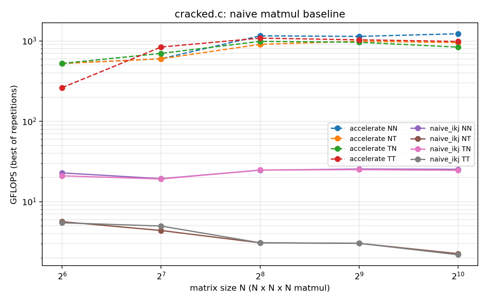

# cracked.c

**got bored. wrote ML in C. it now reads handwriting.**

A neural network library from scratch: memory arenas, matrix kernels, computation graphs, a training loop, and eventually CUDA.

No frameworks. No tutorials. Just C, math, and the occasional segfault (character development).

> **pure C11 · zero dependencies · one translation unit · ~98% on MNIST**
> if you have a C compiler and `make`, you can run everything here.

## what's in here

- **arena allocator**: reserves virtual memory up front, commits pages on demand. Linux, macOS and Windows backends (yes i tested all three, no i'm not proud of the Windows part)
- **PCG PRNG**: my own random number generator. it once returned exactly 1.0 when it shouldn't. the test caught it, so now there's a range test.
- **matrix kernels**: matmul, relu, softmax, cross-entropy, He init, plus all their backward pass.
- **autograd engine**: static computation graph, topo sorted, forward and backward. build the graph once, train forever, allocate nothing
- **IDX loader**: parses MNIST's file format with explicit big-endian decoding, so it works on any CPU. has tests for corrupt files and leaked file handles because i've been burned before
- **training loop**: shuffled mini-batch SGD, accuracy eval, all inside the library. no more copy pasting a loop into every experiment
- **unity build**: everything `#include`s everything. one translation unit, no linker, zero dependencies.

## does it learn

yeah. like, actually now.

`experiments/mnist_train.c` trains a 784-256-128-10 MLP on MNIST. 10 epochs, batch 64, lr 0.1:

```
before training: test accuracy 12.13%  (guessing would be 10%)

epoch  1/10  train loss 0.3070  test accuracy 95.52%
epoch  2/10  train loss 0.1369  test accuracy 96.60%
epoch  5/10  train loss 0.0579  test accuracy 97.58%
epoch 10/10  train loss 0.0201  test accuracy 97.94%

final: train accuracy 99.69%, test accuracy 97.94%
```

~5.5 s per epoch, pure C, no BLAS, no GPU, no pytorch. 97.94% on the test set from a bias-free MLP built on a naive matmul i'm still mad about.

yes the train/test gap says it's memorising a little. we're calling it "confidence". full log lives in [`docs/results/mnist_baseline.txt`](docs/results/mnist_baseline.txt).

also the whole network passes a finite-difference gradient check, so the backward pass isn't just vibe. and `experiments/overfit_tiny.c` still memorises 8 random samples, for sanity:

```
step    loss
   0    1.0210     <- knows nothing (ln 3 = 1.0986)
 300    0.0048

accuracy on the 8 training samples: 8 / 8
```

peak machine learning.

## benchmarks

`make bench` races my matmul against Apple Accelerate on an M1.

| size | cracked.c (naive) | Accelerate |
|---|---|---|
| 1024 x 1024 | ~24 GFLOPS | ~1100 GFLOPS |

yes. i lost by 45x. fixing that is next.



the plot has a second plot twist: when `b` is transposed, my naive kernel falls off a cliff to ~2 GFLOPS (about 10x slower than the untransposed case). half of every backward pass (the gradient flowing back into each layer's inputs) lands on that slow path, so it's a big part of the training time. first thing getting fixed.

## run it

```
make test           # debug build with ASan + UBSan, runs every suite
make test-release   # -O2, since some bugs only show up optimised
make bench          # matmul baseline, writes a csv
```

train on MNIST yourself:

```
sh scripts/get_mnist.sh                                  # grabs the 4 files into data/mnist/
mkdir -p build
clang -std=gnu11 -O2 -I. experiments/mnist_train.c -o build/mnist_train -lm
./build/mnist_train                                      # optional args: epochs lr batch
```

## known limitations (a.k.a. things i'm pretending are features)

- no bias term yet. broadcasting is not implemented, so it's a bias-free MLP. it hits ~98% on MNIST anyway, so ¯\\\_(ツ)\_/¯
- matmul is naive and slow (see above, i'm not over it)
- no momentum, no Adam, no LR schedule. it's plain SGD and it's fine
- CUDA is currently a promise

## roadmap

- [x] arena allocator
- [x] matrix ops + gradients
- [x] computation graph + autograd
- [x] training loop
- [x] MNIST
- [ ] bias + broadcasting
- [ ] faster matmul (cache blocking, SIMD, threads)
- [ ] CUDA

## status

Work in progress. Things will break. Some commits will just say "fix".

*for plot purposes.*